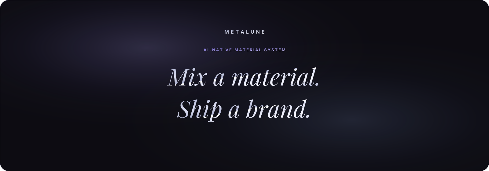
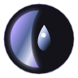

<p align="center">
  
</p>

<h1 align="center">Metaluna <em>·</em> Image Studio</h1>

<p align="center">
  <em>Describe a frame. Watch it surface.</em><br>
  A single-page studio that casts a numbered edition of images — one frame at a time.
</p>

<p align="center">
  
  
  
  
</p>

<p align="center">
  <a href="#overview">Overview</a> &middot;
  <a href="#quick-start">Quick start</a> &middot;
  <a href="#the-studio">The studio</a> &middot;
  <a href="#how-it-works">How it works</a> &middot;
  <a href="#timing">Timing</a> &middot;
  <a href="#naming-and-downloads">Naming</a> &middot;
  <a href="#design-system">Design system</a> &middot;
  <a href="#project-structure">Structure</a> &middot;
  <a href="#deploy">Deploy</a>
</p>

<p align="center">
  
</p>

## Overview

Metaluna is a fictional image studio with an editorial soul: an obsidian floor, vitreous glass planes, and a single unhurried task. You write what you want to see, give the set a name, choose how many frames and what shape — then the foundry answers one image at a time, each still landing on the light table the moment it is ready.

There is no framework, no bundler, and nothing to install. The whole studio is static HTML, one stylesheet, and one vanilla JavaScript file, with Tailwind and JSZip pulled from CDNs. The generation service lives in a Colab notebook behind a tunnel; point the studio at it and start casting.

> **The contract is simple.** One prompt, one frame per request, one honest progress line. No spinners pretending to know more than they do.

| | |
| :--- | :--- |
| **Set size** | 1 – 4 images, rendered sequentially |
| **Ratios** | `1:1` · `4:3` · `3:4` · `16:9` · `9:16` |
| **Files** | `Name-1.png` … `Name-4.png`, packed as `Name.zip` |
| **Viewer** | Fullscreen; <kbd>Esc</kbd> closes, <kbd>←</kbd> <kbd>→</kbd> move |
| **Remembers** | Backend URL and notebook link, in `localStorage` |
| **Needs** | A modern browser and a reachable backend |

<p align="center">
  
</p>

## Quick start

```bash
git clone https://github.com/venkataramavinaybandla-crypto/Metaluna.git
cd Metaluna
python -m http.server 8000
```

Open `http://localhost:8000`, then open the settings button in the header.

1. **Backend URL** — already prefilled with the current tunnel. Paste a fresh one whenever the Colab tunnel restarts.
2. **Colab notebook link** — your notebook. When the foundry is asleep, the header offers **Wake the foundry**, which opens this link in a new tab.

Both values are saved in this browser only. Nothing else leaves the page.

<p align="center">
  
</p>

## The studio

The layout is built around a casting table: controls on one plane, the contact sheet on the other, and a quiet status light above it all.

| Surface | What it does |
| :--- | :--- |
| **Status pill** | Polls the backend's health and reads **Foundry online** with a calm glow, or **Foundry asleep**. |
| **Wake strip** | Appears only when offline: a wake link and one instruction — *In Colab press <kbd>Ctrl</kbd>+<kbd>F9</kbd> and wait about 3 minutes.* |
| **Settings drawer** | Backend URL and Colab notebook link, saved locally as you type. |
| **Console** | Prompt, set name, image count, ratio picker, generate and regenerate. |
| **Contact sheet** | Images arrive one by one, each with its own download; **Download all** packs the set. |
| **Viewer** | Click any image for a fullscreen look, with index and set name beneath it. |

### Keys and details

| Input | Action |
| :--- | :--- |
| <kbd>Esc</kbd> | Close the viewer or the settings drawer |
| <kbd>←</kbd> / <kbd>→</kbd> | Move through the set in the viewer |
| Click outside | Close the viewer |
| <kbd>Tab</kbd> | Move through every control — pills, ratios, downloads, viewer |

While a set is casting, the button becomes a progress readout — *Image 2 of 4* — with a thin ring, an elapsed clock, and the estimate beside it. **Regenerate** reruns the last request exactly as it was.

<p align="center">
  
</p>

## How it works

Every image is its own request, always with `count: 1`. The next one begins only when the previous image has landed, so the contact sheet fills in real time instead of waiting for the slowest frame.

```http
POST {backendUrl}/generate
Content-Type: application/json

{
  "prompt": "A slab of dark violet glass poured over brushed pewter, one blade of lilac light grazing the edge",
  "count": 1,
  "ratio": "1:1"
}
```

The service answers with a data URI and its dimensions:

```json
{
  "images": ["data:image/png;base64,iVBORw0KGgo…"],
  "width": 1024,
  "height": 1024,
  "seconds": 41.2
}
```

`ratio` must be exactly one of `1:1`, `4:3`, `3:4`, `16:9`, `9:16`. On network failure the studio says **Backend offline. Paste a fresh URL from Colab.** — no invented retries, no silent spinning.

The header checks `{backendUrl}/health` every ten seconds. The Colab service must answer cross-origin requests, since the studio is a static page.

<p align="center">
  
</p>

## Timing

`SECONDS_PER_IMAGE = 80` sits at the top of `js/studio.js` and drives every number on the page. The count picker shows the per-image estimate and the total before you commit; the timer shows elapsed time and the same total while it works.

| Images | Estimate | The studio says |
| :---: | :---: | :--- |
| 1 | 1:20 | `~1:20 per image, about 1:20 total` |
| 2 | 2:40 | `~1:20 per image, about 2:40 total` |
| 3 | 4:00 | `~1:20 per image, about 4:00 total` |
| 4 | 5:20 | `~1:20 per image, about 5:20 total` |

If a single frame runs past its estimate, the studio adds one quiet line: **taking longer than usual**. That is the only other time it mentions.

<p align="center">
  
</p>

## Naming and downloads

A name turns the contact sheet into an edition. Files are numbered in display order, and the extension comes from the data URI's MIME type.

| You type | You get |
| :--- | :--- |
| `Obsidian Nocturne` | `Obsidian_Nocturne-1.png`, `Obsidian_Nocturne-2.png`, `Obsidian_Nocturne.zip` |
| `ink study 04` | `ink_study_04-1.png`, `ink_study_04.zip` |
| *(empty)* | Downloads stay disabled, with the hint **Name your set first** |

- Spaces become underscores; `/ \ : * ? " < > |` are stripped away.
- Download sits directly under each image; **Download all** sits under the grid.
- The zip is built in the browser with **JSZip 3.10.1** and named `Name.zip`.
- Images exist only in the page until you download them — nothing is uploaded or stored.

<p align="center">
  
</p>

## Design system

The full token set lives in [`DESIGN.md`](DESIGN.md). The studio uses a deliberately narrow slice of it.

| Token | Value | Use |
| :--- | :--- | :--- |
| Obsidian floor | `#0D0C12` | The ground beneath every plane |
| Lilac | `#A89CF2` → `#D6CEFF` | Primary actions, focus, progress |
| Glaucous | `#7C93C9` → `#B4C4EC` | Secondary metadata and telemetry |
| Snow | `#DCDFF2` | Edge light, timers, quiet emphasis |
| Cards | `28px` radius | Console, contact sheet, settings drawer |
| Controls | `9999px` radius | Every button, pill, input, and ratio chip |
| Display | Playfair Display | Headlines and numerals, with natural italics |
| Interface | Inter | Labels, copy, and controls |

Glass planes use `backdrop-filter: blur(24px)`, 1px gradient hairline borders, and a soft lilac ambient glow instead of hard shadows. Motion is slow and physical — drifting auras, a breathing status light, a sheen that crosses the generate button — and collapses under `prefers-reduced-motion`.

<p align="center">
  
</p>

## Project structure

```text
.
├── index.html                    # The studio: header, console, contact sheet, viewer, settings
├── css/
│   └── studio.css                # Tokens, glass, layout, motion, responsive rules
├── js/
│   └── studio.js                 # Sequential generation, health polling, naming, downloads
├── DESIGN.md                     # Design tokens and visual language
├── assets/
│   ├── images/
│   │   └── metalune-emblem.png   # Wordmark emblem and favicon
│   └── readme/
│       ├── banner.svg            # Header banner
│       └── divider.svg           # Section hairline with centered droplet
└── README.md
```

The page loads Tailwind and Material Symbols from CDNs, Playfair Display and Inter from Google Fonts, and JSZip from cdnjs. Everything else is local.

<p align="center">
  
</p>

## Deploy

Any static host works. On Vercel:

- **Framework Preset:** `Other`
- **Build Command:** none
- **Output Directory:** project root (`./`)

Because the page is served over HTTPS, the backend tunnel must also be HTTPS.

<p align="center">
  
</p>

## Notes

- **One tunnel, one session.** The Colab URL is temporary. When it changes, open settings, paste the new one, and the pill will find the foundry again.
- **Everything is illustrative.** The studio, the brand, and the foundry copy are fiction; the images are yours.
- **Accessible by default.** Live status announcements, labelled controls, visible focus, keyboard navigation, and a reduced-motion path.
- **No tracking.** No analytics, no accounts, no cookies; only two strings in `localStorage`.

<p align="center">
  
</p>

<p align="center">
  
</p>

<p align="center">
  <sub><strong>Metaluna</strong> — cast in the browser, one frame at a time.</sub>
</p>
