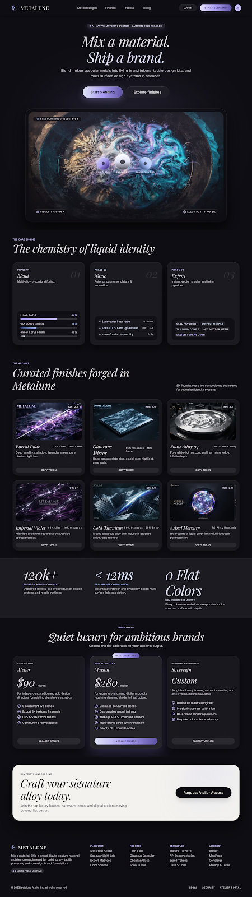
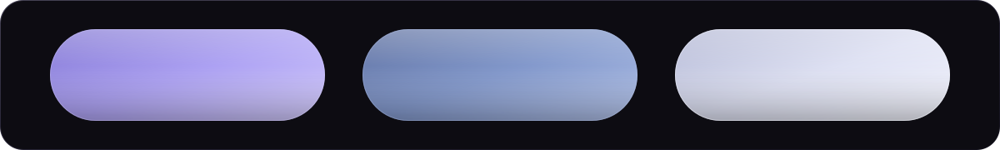

<p align="center">
  
</p>

<p align="center">
  <a href="#overview">Overview</a> &middot; <a href="#the-alloys">Alloys</a> &middot; <a href="#the-mixer">Mixer</a> &middot; <a href="#design-system">Design System</a> &middot; <a href="#run-locally">Run</a> &middot; <a href="#deploy">Deploy</a>
</p>

<p align="center">
  
</p>

## Overview

Metalune is a fictional AI-native material design platform presenting an editorial interface for tactile digital matter. The marketing site is built with static HTML, CSS, and vanilla JavaScript without a build step, using Tailwind via CDN alongside Playfair Display and Inter typography. Its hero mixer is implemented in raw WebGL2 with an automatic WebGL1 fallback and no external libraries.

Every price, stat, and company detail on the site is illustrative.

<p align="center">
  
</p>

## Preview

<details>
  <summary>Stitch design reference</summary>
  <br>
  <p align="center">
    
  </p>
</details>

<p align="center">
  
</p>

## The Alloys

<p align="center">
  
</p>

| Alloy | Shadow | Base | Highlight | Role |
| :--- | :--- | :--- | :--- | :--- |
| Lilac Alloy | `#7B6FD0` | `#A89CF2` | `#D6CEFF` | Core interactive states, brand accent markers, and focused elements |
| Glaucous Alloy | `#55689A` | `#7C93C9` | `#B4C4EC` | Structural data tiers, secondary interaction layers, and contextual telemetry |
| Snow Alloy | `#AEB3D1` | `#DCDFF2` | `#F6F7FF` | High-contrast metallic edge lighting, specular gleams, and tertiary metadata |

<p align="center">
  
</p>

## The Mixer

The hero stage features a real-time fluid simulation basin where users pour and stir chromatic alloys. Droplets can be introduced directly into the suspension, while cursor gestures stir and distribute the fluid across the basin.

| Input | Action | Description |
| :--- | :--- | :--- |
| Mouse | Pour | Drag an alloy drop onto the basin, or click a drop then click the basin |
| Mouse | Stir | Drag across the basin surface |
| Touch | Pour | Drag an alloy drop onto the basin, or tap a drop then tap the basin |
| Touch | Stir | Drag across the basin surface |
| Keyboard | Pour Drop | Tab to an alloy drop and press Enter to pour at basin center |
| Keyboard | Move Cursor | Tab into the basin and use Arrow keys to steer the cursor ring |
| Keyboard | Pour in Basin | Press Space to pour at current cursor ring position |
| Keyboard | Exit Basin | Press Escape to release basin focus |

Controls include a Reset button to clear the basin and a Copy Blend Token button that copies a CSS custom-property gradient generated from the live Lilac, Glaucous, and Snow mixture.

The HUD telemetry panel displays three real-time measurements:
- Specular Roughness: Surface micro-facet reflection profile.
- Viscosity: Fluid shear resistance governing current dampening.
- Blend Balance: Normalized entropy representing the distribution of the active mixture.

<p align="center">
  
</p>

## Design System

The visual language follows the theme of liquid metal under dark glass, pairing high-contrast typography with frosted translucent tiers and specular reflections.

| Subsystem | Specification | Description |
| :--- | :--- | :--- |
| Typography | Display (Playfair Display, 400 / 500) | Monumental headlines and hero titles; natural italics for expressive accents |
| Typography | Interface (Inter, 400 / 500 / 600) | Body text, data grids, and interactive navigational controls |
| Typography | Meta (Inter `label-caps`, 600) | Uppercase badges and technical stamps with `0.12em` letter-spacing |
| Shape | Cards & Panels | Strict `28px` (`1.75rem`) border radius on vitreous containers |
| Shape | Controls & Pills | Continuous pill capsules (`border-radius: 9999px`) on buttons and indicators |
| Elevation | Ground Substrate | `#0D0C12` obsidian floor absorbing ambient light |
| Elevation | Vitreous Planes | Secondary tiers at `rgba(22, 20, 31, 0.65)` with `backdrop-filter: blur(24px)` |
| Elevation | Specular Outlines | 1px border gradient from `rgba(214, 206, 255, 0.28)` to `rgba(123, 111, 208, 0.05)` |
| Elevation | Sheen & Lighting | Inset rim highlight `rgba(246, 247, 255, 0.12)` and diffuse ambient lilac glow |

<p align="center">
  
</p>

## Project Structure

```text
.
├── DESIGN.md                                 # Design system token definitions and styling guidelines
├── assets/
│   ├── images/
│   │   ├── hero-liquid-basin.jpg             # Static basin fallback image when WebGL is inactive
│   │   ├── metalune-emblem.png               # Metalune brand emblem mark
│   │   ├── swatch-astral-mercury.jpg         # Astral Mercury finish imagery
│   │   ├── swatch-boreal-lilac.jpg           # Boreal Lilac finish imagery
│   │   ├── swatch-cold-titanium.jpg          # Cold Titanium finish imagery
│   │   ├── swatch-glaucous-mirror.jpg        # Glaucous Mirror finish imagery
│   │   ├── swatch-imperial-violet.jpg        # Imperial Violet finish imagery
│   │   └── swatch-snow-alloy-04.jpg          # Snow Alloy 04 finish imagery
│   └── readme/
│       ├── alloys.svg                        # Vector swatches of the three alloy bars
│       ├── banner.svg                        # Repository header banner with outlined type
│       └── divider.svg                       # Section hairline divider with centered droplet
├── code.html                                 # Standalone marketing layout markup
├── css/
│   └── styles.css                            # Glassmorphic filters, tokens, and structural rules
├── index.html                                # Primary landing page markup and mixer interface
├── js/
│   ├── app.js                                # UI event bindings, swatch switching, and interactions
│   └── mixer.js                              # WebGL2/WebGL1 fluid simulation and token generator
├── reference/
│   ├── DESIGN.md                             # Stitch-generated design token specifications
│   ├── code.html                             # Stitch reference page markup
│   └── screen.png                            # Stitch full-page design reference capture
└── screen.png                                # Root reference screenshot
```

<p align="center">
  
</p>

## Run Locally

Clone the repository and start a local HTTP server:

```bash
git clone https://github.com/venkataramavinaybandla-crypto/Metaluna.git
cd Metaluna
python -m http.server 8000
```

Open `http://localhost:8000` in a web browser. No build step or package installation is needed.

<p align="center">
  
</p>

## Deploy

Deploy to Vercel with zero build configuration:

- Framework Preset: `Other`
- Build Command: None (leave blank)
- Output Directory: Project root (`./`)

<p align="center">
  
</p>

## Fallbacks and Accessibility

- When WebGL2 and WebGL1 are unavailable, the basin displays `assets/images/hero-liquid-basin.jpg` as a static image fallback.
- Under `prefers-reduced-motion`, the basin renders a single static frame instead of continuous animation loops.
- Full keyboard controls allow navigating between drops, centering pours, steering the basin cursor ring, and triggering blends.
- High-contrast typography pairs light metallic values against dark vitreous containers.
- Embedded vector graphics include `<title>` and `<desc>` accessibility tags for screen readers.

<p align="center">
  
</p>

## Credits

- Design generated in Stitch.
- Built with Antigravity.
- Hero and finish imagery AI-generated in Stitch.
